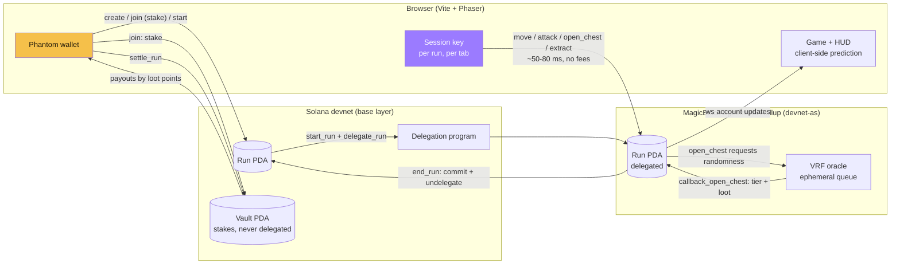

# Extraction Dungeon

**Stake SOL, loot the dungeon, fight other players, and get out alive. Whatever you extract with is yours.**

A real-time, staked PvP extraction game on Solana for MagicBlock **Solana Blitz v10** (Entertainment Finance).
Every step, hit and chest happens on a **MagicBlock Ephemeral Rollup** (no fees, ~50–80 ms), **MagicBlock VRF** decides
what's inside each chest, and the pot settles back on Solana when the run ends.

- **Play:** https://extraction-dungeon-three.vercel.app (devnet: Phantom in testnet mode + [faucet SOL](https://faucet.solana.com))
- **Program (devnet):** [`2c1W2MUPCkF6bdcKvKXmLePwBorg6yy8L1A6BdoDBBqw`](https://explorer.solana.com/address/2c1W2MUPCkF6bdcKvKXmLePwBorg6yy8L1A6BdoDBBqw?cluster=devnet)
- **ER:** `devnet-as.magicblock.app` (validator `MAS1Dt9qreoRMQ14YQuhg8UTZMMzDdKhmkZMECCzk57`)

## How a run works

1. **Lobby (Solana).** A host opens a run with an entry stake and a timer. Up to 4 players join; each stake goes into a
   program-owned **vault that never leaves the base layer**. Each player also registers a browser **session key**.
2. **Into the rollup.** Starting the run delegates the `Run` account to the Ephemeral Rollup, all in one transaction.
3. **Play (Ephemeral Rollup).** Arrow keys move one tile per step. Walk into a player to hit them (3 hits kill). Walk into a
   chest to open it, and **VRF rolls the tier**: common 1 pt (60%), rare 3 pts (30%), legendary 8 pts (10%). When you die
   your bag drops on your tile, and anyone can walk over and take it. Stand on an **EXIT** and press **E** to leave with your bag.
   Every action is signed by the session key: no wallet popups, no fees, ~50–80 ms per action.
4. **Back to Solana.** When the timer runs out, or everyone is dead or out, the run is committed and undelegated.
5. **Settle.** Players who extracted split the pot **in proportion to their loot points**. Anyone trapped or slain gets nothing.
   If nobody makes it out, the house keeps the pot.

The tension is the whole game: every second you stay, there's more loot and more chance someone takes your bag.

## Architecture



### MagicBlock integration
| Piece | Where | Notes |
|---|---|---|
| **Ephemeral Rollup** delegation | `delegate_run` (`#[delegate]`) | Sent in the same tx as `start_run`; the validator is pinned via `remaining_accounts` |
| Commit + undelegate | `end_run` (`#[commit]`, `MagicIntentBundleBuilder::commit_and_undelegate`) | Authority any time; anyone once the timer is up or everyone is resolved |
| **VRF** inside the ER | `open_chest` (`#[vrf]`, `create_request_randomness_ix_const`) → `callback_open_chest` (`#[vrf_callback]`) | Uses `DEFAULT_EPHEMERAL_QUEUE`; ~0.7–2 s on devnet; costs the session key 0 lamports |
| Session keys | `join_run(session_signer)` | A browser keypair stored in the `Run`; every ER action is checked against it |

`ephemeral-rollups-sdk = 0.18` (`anchor`, `vrf`), `anchor-lang = 1.1.2`, `@magicblock-labs/ephemeral-rollups-sdk 0.18.0`.

### Things we learned the hard way (maybe useful to MagicBlock and other builders)
- **`#[vrf_callback]` in SDK 0.18 burns the whole 200k CU budget.** The injected `vrf_program_identity` constraint evaluates
  `scoped_vrf_identity_const(&crate::ID)` at runtime (a software PDA derivation). Workaround: declare the field yourself
  with `#[account(address = CONST)]` where `CONST` is a `const` item, which forces compile-time evaluation
  ([lib.rs](programs/extraction_dungeon/src/lib.rs)).
- **Identical ER transactions inside one blockhash get dropped** ("already processed"): two `move(Down)` in a row are the
  same bytes. We add a rotating `ComputeBudget` instruction so every action is unique.
- **Anchor pins.** `anchor-lang = "=1.0.2"` pulls 1.2.2 macro crates, which emit `create_account_allow_prefund`. Pin
  everything to one version (`cargo update -p anchor-* --precise 1.1.2`).
- **Local stack.** With `ephemeral-validator 1.1.1` locally, commits back to base fail (`failed to deserialize
  VersionedTransaction: failed to fill whole buffer`), and there's no oracle on the ephemeral queue. Devnet works.

## Real-time feel
| | |
|---|---|
| Endpoint RTT from the dev machine | asia 75 ms · eu 145 ms · router 180 ms · us 230 ms |
| Input-queue block per action | **78 ms** p50 (cached ER blockhash, fire-and-forget, `processed` confirmation in the background) |
| On-chain, end to end | 9 moves landed in 1.56 s on devnet-as |
| On screen | Your own moves are predicted instantly; chain state wins after 1.5 s if it disagrees |

## Repository
```
programs/extraction_dungeon/src/
  lib.rs     instructions + accounts
  state.rs   Run / PlayerSlot / Chest / DroppedBag, payout math (+ unit tests)
  map.rs     the 12x9 room, spawns, chests, exits (mirrored in the client)
tests-magicsvm/tests/run.rs   end-to-end scenarios in MagicSVM (base + ER + VRF)
app/
  src/chain.ts   all RPC and transaction building (shared with the scripts)
  src/main.ts    screens, input, prediction
  src/game.ts    Phaser scene drawn purely from on-chain state
  scripts/smoke.ts  full run over real RPC (NET=local | devnet)
docs/        phase reports P0–P3 with test output
```

## Running it
Prereqs: Rust, Solana CLI 3.x, Anchor CLI 1.1.2, Node 22+.

```bash
anchor build
cargo +stable test -p extraction_dungeon --lib          # payout math unit tests
cd tests-magicsvm && cargo +stable test                 # 6 end-to-end scenarios (MagicSVM)

cd app && npm install
NET=devnet npx tsx scripts/smoke.ts                     # full run on devnet (needs devnet SOL in ~/.config/solana/id.json)
npm run dev                                             # client (localhost uses the local stack: scripts/start-stack.sh)
```
Open with `?net=devnet` to point a local client at devnet.

## Tests
- **6 unit tests:** proportional split, equal split for empty bags, nobody extracted goes to the house, integer dust goes to the house, tier boundaries.
- **6 MagicSVM scenarios:** stakes and seat rules · movement/walls/chests/session keys · VRF tiers inside the ER ·
  death → bag drop → loot → extract → settle (winner takes exactly the pot) · timer runs out → house · 1:3 split between two extractors.
- **Devnet smoke test:** the full loop including commit, settle and a real VRF chest.

## Not done yet
- Touch controls (the game needs a keyboard).
- Private bags via a Private Ephemeral Rollup, so opponents can't see what you're carrying.
- Collectible mints for legendary drops.
- Closing finished run accounts to reclaim rent.
