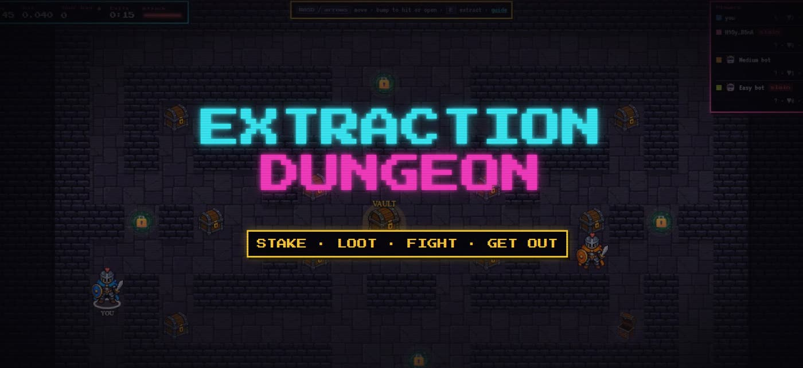
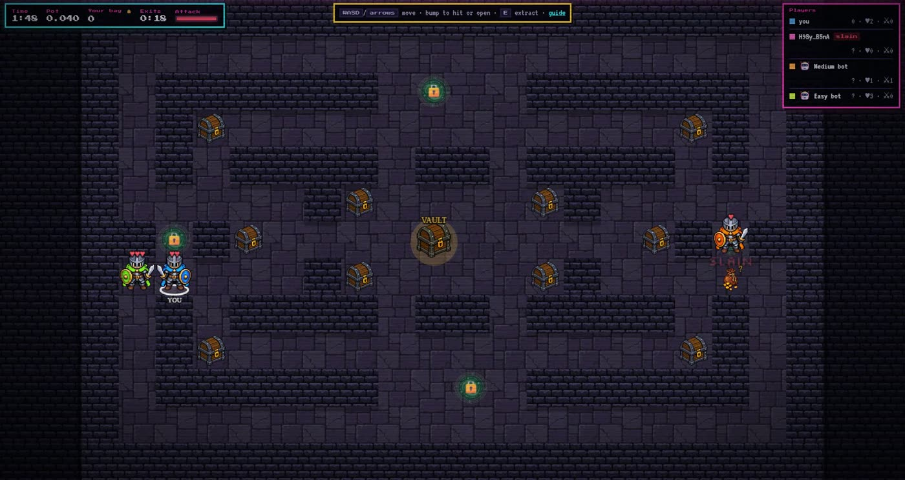
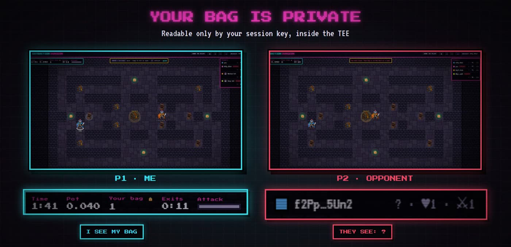
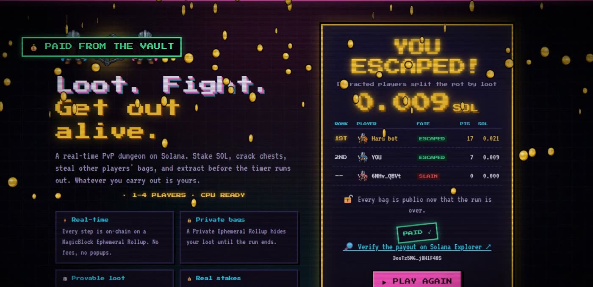
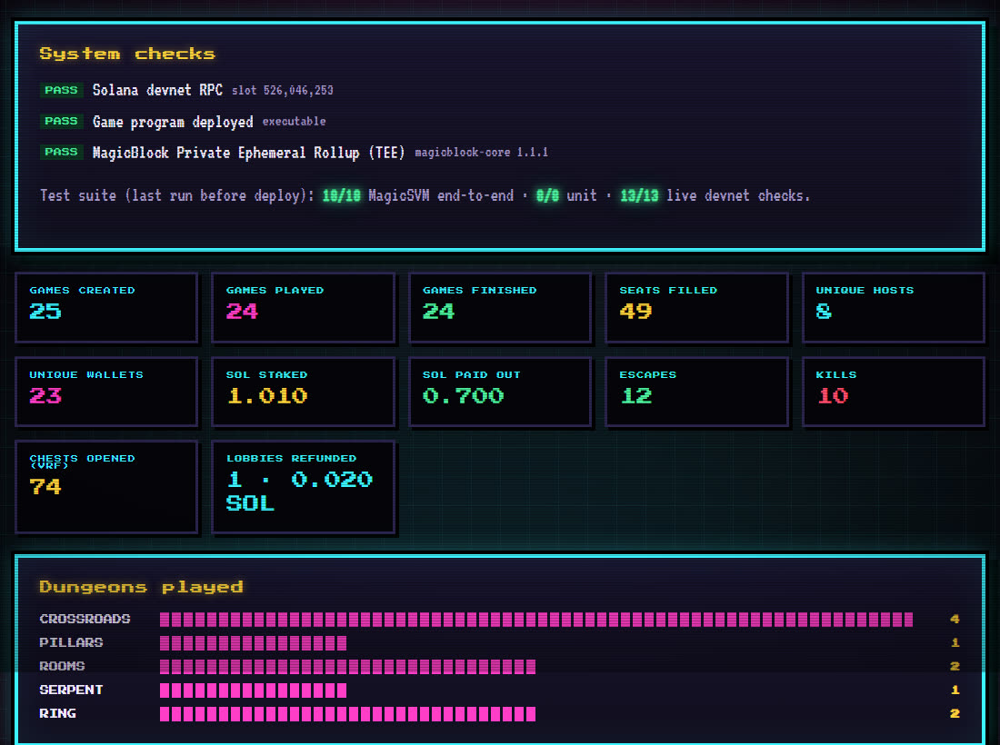

<div align="center">



# ▶ EXTRACTION DUNGEON

**Stake SOL. Loot the dungeon. Fight. Get out alive.**<br/>
A real-time, staked PvP extraction game where every move is a Solana transaction,<br/>
and nobody can see what you're carrying.

      

[](https://extractiondungeon.vercel.app)
[](https://extractiondungeon.vercel.app/stats)
[](https://explorer.solana.com/address/2c1W2MUPCkF6bdcKvKXmLePwBorg6yy8L1A6BdoDBBqw?cluster=devnet)

%20·%20VRF-9b7bff?style=flat-square)


</div>

---

## 🕹️ INSERT COIN

Extraction Dungeon is our entry for **MagicBlock Solana Blitz v10 (Entertainment Finance)**, built from MagicBlock's
"Extraction dungeon" idea and dressed as an arcade cabinet.

- **Real stakes.** 1 to 4 players stake SOL into a program vault that never leaves Solana.
- **Real time.** The run moves onto a **MagicBlock Private Ephemeral Rollup**: every step, hit and chest is an on-chain
  transaction, signed by a browser session key. No fees, no wallet popups, millisecond confirmations.
- **Hidden information.** Your loot lives in a **private bag** that only your session key can read, inside a TEE.
  Opponents see a chest open and a "?" over you. Nobody knows who's worth robbing.
- **Provable loot.** **MagicBlock VRF** rolls every chest inside the rollup.
- **Real payouts.** When the run ends, everything commits back to Solana, the bags are revealed, and the program pays the
  players who escaped, split by loot. Verify it on Solana Explorer.

| | |
|---|---|
| ▶ **Play** | https://extractiondungeon.vercel.app (devnet: Phantom in testnet mode + [free devnet SOL](https://faucet.solana.com)) |
| 📊 **Live stats** | https://extractiondungeon.vercel.app/stats: every game, read straight from the chain |
| 📼 **Demo video** | [2:58 demo with gameplay and voice-over, on X](https://x.com/NisargPatel5563/status/2125804554784813237) |
| 🔗 **Program** | [`2c1W2MUPCkF6bdcKvKXmLePwBorg6yy8L1A6BdoDBBqw`](https://explorer.solana.com/address/2c1W2MUPCkF6bdcKvKXmLePwBorg6yy8L1A6BdoDBBqw?cluster=devnet) (devnet) |
| 🔒 **Rollup** | `devnet-tee.magicblock.app` (TEE validator `MTEWGuqxUpYZGFJQcp8tLN7x5v9BSeoFHYWQQ3n3xzo`) |

<div align="center"></div>

---

## 🎮 HOW TO PLAY

**Get in.** Press **Create game**, pick a stake (FREE, 0.01, 0.05 or 0.1 SOL) and a timer (2, 3 or 5 minutes). One wallet
approval creates the run, seats you as **P1** and sets up your private bag. Fill the other seats by sharing the invite
link, or with **CPU** players. Press **Start game**.

| | Rule |
|---|---|
| 🧰 **Chests** | Walk into one to open it. VRF rolls **common 1 pt** (50%), **rare 3 pts** (30%) or **legendary 8 pts** (10%), and only you see the result. |
| 🦷 **Mimics** | 10% of chests are **mimics**: no loot, and they **bite for 1 heart** and break your extraction. A mimic can kill you, and then your bag drops for everyone. |
| 👑 **The Vault** | The glowing chest in the middle never rolls common or a mimic (rare or legendary only). That's where the fights happen. |
| 👹 **Vault Guardians** | Two horned demons stand beside the Vault. They **chase anyone within 3 tiles of their post, bite** (1 heart, at most every ~2 s) and walk home when you run. **3 hits kill one for a +2 bounty** into your private bag. They block tiles, so the Vault has to be earned. A **MagicBlock crank** on the rollup moves them: nobody's browser drives the monsters. |
| ⚔️ **Combat** | Walk into a player to hit them. **3 hits kill**, with a **0.4 s cooldown**, so spam-clicking doesn't win. |
| 💀 **Sacks** | When you die, your whole bag drops as a sack marked **?**. Whoever walks over it takes everything, without knowing how much it is. |
| 🔒 **Exits** | Exits unlock a **quarter of the way in**. Stand on one and **channel for 2 s** to extract; moving or getting hit cancels it. |
| ⏱️ **Timer** | Still in the dungeon when time runs out? You lose your bag. |
| 💰 **Payout** | Players who escaped split the pot **in proportion to their loot**. Claim it, then verify the payout on Solana Explorer. |

**The announcer.** FIRST BLOOD, kills, GUARDIAN SLAIN, VAULT CRACKED, escapes, LAST ONE STANDING and HURRY UP flash
across the screen as arcade banners, and a kill feed in the corner says who got whom (a player, a guardian or a mimic).

**Controls.** PC: **WASD / arrows** to move, bump to hit or open, **E** to extract. Phone and tablet: on-screen **D-pad** and
an **EXIT** button. A six-step **How to play** guide opens on the first visit.

---

## 🗺️ FIVE DUNGEONS

Every run is played on one of five mirror-symmetric 20×13 layouts, picked at random, so no two rounds feel the same. Each
has ten chests, the Vault, four exits and four corner spawns, and a test checks that every tile is reachable on every map.

| CROSSROADS | PILLARS | ROOMS | SERPENT | RING |
|---|---|---|---|---|
| Classic corridors | Open hall of pillars | Four walled rooms | Winding lanes | An outer ring around the Vault |

---

## 🤖 CPU PLAYERS

No one around? Add **Easy, Medium or Hard** CPUs in the lobby. A CPU is a **real on-chain player**: your wallet funds a fresh
CPU wallet and it joins in the same transaction (one approval), so it stakes, has its own private bag, and can be killed and
looted. Its brain runs in your tab and acts through its own session key. After the payout, everything it won comes back to you.

| Level | Plays like |
|---|---|
| Easy | Slow (~1 action/s), wanders, rarely fights, leaves early with little loot |
| Medium | Loots steadily, fights back, grabs sacks, extracts with ~8 pts or a third of the run left |
| Hard | Fast (~4 actions/s), hunts players in range, raids the Vault, ambushes anyone channeling at an exit, holds out for ~14 pts |

Set the stake to **FREE** for a practice run.

---

## 🔐 PRIVATE BY DESIGN

<div align="center"></div>

| Public on the rollup | Private (owner's session key only) | Public after the run |
|---|---|---|
| Positions, HP, kills, who extracted | Your loot points | Every bag's points |
| Which chests are open, and who opened them | What tier your chest rolled | (the payout uses them) |
| Where a sack lies | What's inside a sack | |

---

## 💰 YOUR STAKE IS SAFE

The program enforces these, not a server:

- 🛑 **No early endings.** Nobody, not even the host, can end a run before the timer runs out or every player is out or dead.
- 🚫 **No host cut.** The whole pot goes to players.
- ↩️ **Nobody escapes = refund.** Every stake goes back.
- ✖ **Abandoned lobby = refund.** The host can cancel a lobby that never started; if the host walks away, anyone can cancel
  it after 10 minutes. Every stake is refunded.
- 🔎 **Verifiable.** The results screen links the payout or refund transaction on Solana Explorer.

<div align="center"></div>

---

## ⚡ MAGICBLOCK INSIDE

| Feature | Where | How |
|---|---|---|
| **Private Ephemeral Rollup (TEE)** | `delegate_run`, `delegate_bag`, `init_bag_permission`, `init_run_permission` | The run and one Bag PDA per seat are delegated to the TEE validator. Each seat's session key creates an ER-local permission (`CreateEphemeralPermissionCpi`, `is_private: true`, members = itself), so only it can read its bag; the run gets a public one. Clients authenticate with `getAuthToken`, signed locally by the session key. |
| **Ephemeral Rollups** | `move_player`, `attack`, `start_extract`, `extract` | All gameplay runs on the rollup. Moves are fire-and-forget with client-side prediction, so your knight moves instantly. |
| **Commit + undelegate** | `end_run` (`#[commit]`, `MagicIntentBundleBuilder::commit_and_undelegate`) | Commits the run and every bag back to Solana in one intent. |
| **VRF** | `open_chest` (`#[vrf]`, `create_request_randomness_ix_const`) → `callback_open_chest` (`#[vrf_callback]`) | Randomness from the ephemeral queue, inside the PER. The callback (gated by the program's scoped VRF identity) writes the tier into the opener's **private** bag, about 0.7 s after opening. |
| **Cranks** | `start_guardians` → `tick_monsters` | The host's session key schedules a task on the rollup's own scheduler (`ScheduleTask`). Every 0.7 s it calls `tick_monsters`, signed by the crank signer PDA the run records, so the Vault Guardians chase and bite with no client ticking them. Ticks are rate-limited on-chain and no-op after the timer, so extra or late calls are harmless. |
| **Session keys** | `join_run(session_signer)` | A per-run browser keypair registered at join; every rollup action is checked against it, and its leftover SOL is swept back after the run. |

`ephemeral-rollups-sdk 0.18` (`anchor`, `vrf`, `access-control`) · `anchor-lang 1.1.2` · `@magicblock-labs/ephemeral-rollups-sdk 0.18.0`

### Architecture


### Lifecycle of a run

1. **Lobby (Solana).** `create_run` + `join_run` + `delegate_bag` in one transaction: the host's stake goes into the vault,
   their session key is registered, and their private bag is delegated to the TEE. Others join the same way.
2. **Start.** `start_run` + `delegate_run` hand the run to the rollup; each seat creates its bag's private permission.
3. **Play (rollup).** Moves, attacks, VRF chests and extractions, all signed by session keys.
4. **End.** `end_run` commits and undelegates the run and every bag in one intent (anyone can call it, once allowed).
5. **Settle (Solana).** `settle_run` pays escaped players by loot, or refunds everyone if nobody escaped.
   `cancel_run` refunds a lobby that never started.

### Real-time feel

| | |
|---|---|
| Rollup slots | ~11 ms |
| Round trip from the dev machine | devnet-tee ~111 ms, devnet-as ~75 ms |
| On screen | Your moves are predicted instantly; chain state wins after 1.5 s if it disagrees |
| VRF chest | ~0.7 s from open to tier in your bag |

---

## 📱 EVERY SCREEN, EVERY WALLET

- **Pick your device.** The first visit asks **PC / Phone / Tablet**, and the layout follows (change it any time with 🎮).
- **Phones.** Portrait puts the dungeon above a control deck; landscape fits the whole dungeon with the D-pad and EXIT on
  the sides. Choosing Phone or Tablet suggests turning the device sideways.
- **Wallets.** Phantom on desktop. On phones, **Open in Phantom** reopens the game (invite link included) inside Phantom's
  browser, where connecting works. Clear messages if a wallet has no devnet SOL.
- **Fullscreen** on the first tap, click or key (with a toggle), and a web app manifest for home-screen installs.

## 🎵 ARCADE CABINET

An **attract mode** home page with real gameplay looping behind it, CRT scanlines, neon pixel type (Press Start 2P / VT323), a **Player select** lobby with "insert coin" slots, loading bars
between chain hops, a results screen with a score tally, high-score table, **Claim winnings** coin shower and PAID stamp,
and an original chiptune soundtrack, **Crypt Run**, generated in code with WebAudio. It speeds up in the last 30 seconds.
Every sound effect is procedural too. The sprites were generated with Figma's AI image generation in one 16-bit style and
processed by `app/scripts/sprites.ts`.

---

## 📊 LIVE STATS AND ANALYTICS

<div align="center"></div>

- **[/stats](https://extractiondungeon.vercel.app/stats)** reads every game straight from the program's accounts on
  devnet: games created, played and finished, seats filled, unique hosts and wallets, SOL staked, paid out and refunded,
  escapes, kills, VRF chests opened, maps played, and recent games with Explorer links, plus live system checks
  (Solana RPC, program deployed, MagicBlock TEE rollup). No server: anyone can verify the numbers.
- **🏆 Hall of fame**: a leaderboard of every wallet that has played, ranked by net SOL won, then escapes and kills, built
  from the same on-chain accounts with the program's payout formula mirrored in the client.
- **Vercel Web Analytics** for traffic (visitors, countries, devices).
- **Google Analytics 4** gameplay funnel when `VITE_GA_ID` is set: `wallet_connected`, `game_created`, `game_joined`,
  `cpu_added`, `game_started`, `run_finished`, `payout_claimed`, `lobby_cancelled`, `device_selected`, `open_in_phantom`.
  No wallet addresses are sent; local and test sessions aren't counted.

---

## 🧪 TESTED

| Suite | Count | Covers |
|---|---|---|
| Unit (`cargo test -p extraction_dungeon --lib`) | **9** | Mimic odds, payout split, equal split for empty bags, refunds when nobody escapes, rounding dust to the best bag, tier tables, Vault tiers, every map fully connected |
| End-to-end in MagicSVM (`tests-magicsvm`) | **28** | **The rollup's crank drives the guardians with no client ticking** · only one player owns the crank · ticks after the timer are no-ops · Mimics bite, can kill and drop your bag; the Vault is never a mimic · **Vault Guardians** spawn beside the Vault and block it, chase and bite on a rate-limited tick, can kill (bag drops), and pay a private bounty when slain · Stakes, seats and bags delegated at join · **opponents can't read each other's bags** · movement, walls, chests, session keys · chest tiers land only in the private bag · attack cooldown · death → sack → looted → extract → settle · bags can't be swapped · timer → refunds · split by loot · **host can't end a run early to grab the pot** · host and timeout lobby cancels · live runs can't be cancelled · loot + extract on every map · locked exits, channeling, interrupts |
| Live devnet smoke test (`app/scripts/smoke.ts`) | **15** | On the real TEE rollup: owner-only bag reads, VRF chests, a Vault Guardian slain in three hits, **the rollup's crank ticking the guardians on its own**, Vault tiers, locked exits, cooldown, hidden sack contents, channeling, and the exact payout |

---

## 🐛 EDGE CASES WE HIT (AND FIXED)

Written up for the MagicBlock team and other builders:

- **`#[vrf_callback]` in SDK 0.18 burns the whole 200k CU budget**: the injected constraint derives the scoped VRF identity
  at runtime. Fix: declare `vrf_program_identity` yourself with `address = CONST`, where `CONST` is a `const` item.
- **Rollup blockhashes expire in about 2 seconds** (slots are ~11 ms), so a cached blockhash after any pause made moves
  fail with "Blockhash not found". Fix: never sign with one older than 0.9 s, and retry once.
- **Identical rollup transactions in one blockhash are dropped** ("already processed"), e.g. two `move(Down)` in a row. Fix:
  a rotating `ComputeBudget` instruction makes every action unique.
- **On the SBF target, an array-of-structs map table read back zeroed fields** for some entries. Fix: plain per-field const
  arrays, caught by a MagicSVM test that plays every map.
- **Ephemeral permission accounts hold no lamports**, so a `lamports() > 0` "already exists" check is always false. Check
  `!data_is_empty()`.
- **The rollup clock runs 1 to 3 s behind device clocks.** Client countdowns read the chain clock instead.
- **Anchor pins:** `anchor-lang = "=1.0.2"` pulls 1.2.2 macro crates; pin every `anchor-*` crate to one version.
- **Local stack:** with `ephemeral-validator 1.1.1`, commits to the local base fail and the ephemeral VRF queue has no oracle.
  Devnet works.

---

## 🏆 SOLANA BLITZ V10: WHAT IT TAKES, AND WHERE WE STAND

Blitz v10 asks every entry to integrate MagicBlock's **Ephemeral Rollups or VRF**, and judges on **creativity, technical
depth, and how compellingly it showcases what's possible on Solana**. Submissions close **Fri 27 Nov 2026**.

| Requirement / criterion | What we have |
|---|---|
| ✅ **Eligibility:** uses Ephemeral Rollups or VRF | Ephemeral Rollups **and** Private Ephemeral Rollups (TEE) **and** VRF, all carrying the gameplay |
| ✅ **Theme:** Entertainment Finance | Real SOL stakes, a pot split by loot, refunds, verifiable payouts, in an arcade game |
| ✅ **Creativity** | Hidden-information PvP: private bags in a TEE make bluffing and "is he worth robbing?" possible on-chain |
| ✅ **Technical depth** | Delegation, ER-local permissions, VRF callbacks, a crank on the rollup's scheduler, commit + undelegate, session keys; 28 + 9 + 15 tests; real edge cases fixed and documented |
| ✅ **Showcase** | Live on devnet, playable on PC and phone, solo with CPUs, public on-chain stats, Explorer-verified payouts |
| ✅ **Working MVP** | Deployed program, live site, full loop verified on devnet |
| ✅ **Public repo** | This repository |
| ✅ **Demo video** | [Posted on X](https://x.com/NisargPatel5563/status/2125804554784813237) and submitted to Blitz v10 on 26 Nov 2026 |
| ⬜ **Team details** | Fill in [docs/SUBMISSION.md](docs/SUBMISSION.md) |
| ⬜ **Submit** | https://build.magicblock.app/?stage=blitz#submit (log in to see the form) |

Before submitting, it's worth: a fresh run of the devnet smoke test, a quick game on a phone through Phantom, and a look
at `/stats` to make sure the system checks are all **PASS**.

---

## 🛠️ RUN IT YOURSELF

Prereqs: Rust, Solana CLI 3.x, Anchor CLI 1.1.2, Node 22+.

```bash
anchor build
cargo +stable test -p extraction_dungeon --lib          # 9 unit tests
cd tests-magicsvm && cargo +stable test                 # 28 end-to-end scenarios (MagicSVM)

cd app && npm install
NET=devnet npx tsx scripts/smoke.ts                     # live run on devnet-tee (needs devnet SOL in ~/.config/solana/id.json)
npm run dev                                             # client on localhost:5180
```

Open `http://localhost:5180/?net=devnet` to point the local client at devnet. `scripts/deploy-devnet.sh` upgrades the
program on devnet; `app/` deploys to Vercel as a static Vite build.

### Repository map

```
programs/extraction_dungeon/src/
  lib.rs     instructions + account contexts
  state.rs   Run / PlayerSlot / Bag / Chest, payout math (+ unit tests)
  map.rs     the five layouts: walls, spawns, chests + Vault, exits (+ connectivity test)
tests-magicsvm/tests/run.rs   end-to-end scenarios (base + ER + VRF + permissions)
app/
  src/chain.ts     RPC, transaction building, TEE auth, rollup blockhash handling
  src/main.ts      screens, lobby, HUD, input, prediction, results, device + wallet flow
  src/game.ts      Phaser scene drawn purely from on-chain state
  src/bot.ts       CPU players (Easy / Medium / Hard)
  src/sound.ts     procedural sound effects + the Crypt Run soundtrack
  src/stats.ts     the public /stats page
  src/analytics.ts Vercel Web Analytics + GA4 funnel events
  src/guide.ts     the How to play guide
  scripts/smoke.ts live devnet test
docs/        submission text, demo script, build reports, README media
```

---

## 🛣️ NEXT

- Extend the crank so it also ends each run automatically at the buzzer, and a post-commit Magic Action that settles in the same step.
- A public list of open lobbies to join.
- Collectible mints for legendary drops.
- Reclaiming rent from finished runs.

<div align="center">

**Built on MagicBlock · Solana Blitz v10**


</div>
