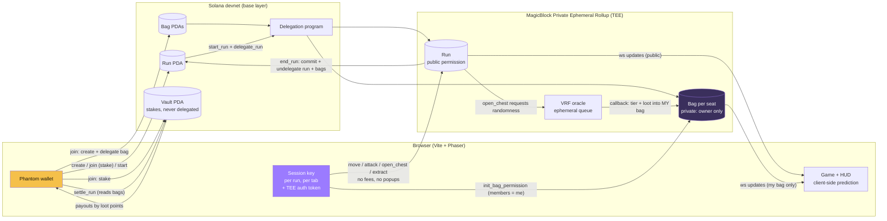

# Extraction Dungeon

**Stake SOL, loot the dungeon, fight other players, and get out alive. Whatever you extract with is yours.**

A real-time, staked PvP extraction game on Solana for MagicBlock **Solana Blitz v10** (Entertainment Finance).
Every step, hit and chest happens on a **MagicBlock Private Ephemeral Rollup** (TEE): no fees, no wallet popups, and
**nobody can see what you're carrying**. **MagicBlock VRF** decides what's inside each chest, and the pot settles back on
Solana when the run ends.

- **Play:** https://extraction-dungeon-three.vercel.app (devnet: Phantom in testnet mode + [faucet SOL](https://faucet.solana.com)). The **How to play** button explains everything in six steps.
- **Program (devnet):** [`2c1W2MUPCkF6bdcKvKXmLePwBorg6yy8L1A6BdoDBBqw`](https://explorer.solana.com/address/2c1W2MUPCkF6bdcKvKXmLePwBorg6yy8L1A6BdoDBBqw?cluster=devnet)
- **Rollup:** `devnet-tee.magicblock.app` (TEE validator `MTEWGuqxUpYZGFJQcp8tLN7x5v9BSeoFHYWQQ3n3xzo`)

## How a run works

1. **Lobby (Solana).** A host opens a run with an entry stake and a timer. Up to 4 players join. Each stake goes into a
   program-owned **vault that never leaves the base layer**. Each player registers a browser **session key** and gets a
   **private Bag** account, delegated to the TEE rollup in the same transaction.
2. **Private by default.** Each player's session key creates a permission on the rollup so **only it can read that Bag**.
   The shared `Run` (positions, HP, which chests are open) gets a public permission.
3. **Play (Private Ephemeral Rollup).** Arrow keys move one tile per step. Walk into a player to hit them (3 hits kill,
   **0.4 s attack cooldown**). Walk into a chest to open it, and **VRF rolls the tier** into your private bag: common 1 pt
   (60%), rare 3 pts (30%), legendary 8 pts (10%). **Only you learn what you got.** Opponents just see the chest open.
   When you die, your whole bag drops as a **sack** marked "?". Anyone can walk over it and take everything inside without
   knowing how much it is. Stand on an **EXIT** and press **E** to leave with your bag.
4. **Back to Solana.** When the timer runs out, or everyone is dead or out, the run **and every bag** are committed and
   undelegated. The bags are now public, so everyone sees what everyone had.
5. **Settle.** Players who extracted split the pot **in proportion to their loot points**. Anyone trapped or slain gets nothing.
   If nobody makes it out, the house keeps the pot.

The tension is the whole game: every second you stay, there's more loot and more chance someone takes your bag. And you
never know whether the player walking at you is carrying 1 point or 20.

## Architecture



### MagicBlock integration
| Piece | Where | Notes |
|---|---|---|
| **Private Ephemeral Rollup** | `delegate_run` / `delegate_bag` → TEE validator; `init_bag_permission` (`CreateEphemeralPermissionCpi`, `is_private: true`, members = the seat's session key); `init_run_permission` (public) | Each Bag PDA is pre-funded at join with the permission's rent and pays for it on the rollup. Clients authenticate with `getAuthToken`, signed locally by the session key |
| Commit + undelegate | `end_run` (`#[commit]`, `MagicIntentBundleBuilder::commit_and_undelegate`) | Commits the run and every bag in one intent. Anyone can end it once the timer is up or everyone is resolved |
| **VRF** inside the PER | `open_chest` (`#[vrf]`, `create_request_randomness_ix_const`) → `callback_open_chest` (`#[vrf_callback]`) | Uses `DEFAULT_EPHEMERAL_QUEUE`. The callback writes the tier and loot into the opener's **private** bag (~0.7 s on devnet-tee) |
| Session keys | `join_run(session_signer)` | A browser keypair stored in the `Run`; every rollup action is checked against it |
| Attack cooldown | `attack` | `ATTACK_COOLDOWN_SLOTS = 36` (~400 ms at ~11 ms rollup slots), tracked per player as `last_attack_slot` |

`ephemeral-rollups-sdk = 0.18` (`anchor`, `vrf`, `access-control`), `anchor-lang = 1.1.2`, `@magicblock-labs/ephemeral-rollups-sdk 0.18.0`.

### What stays private, and what doesn't
| Public on the rollup | Private (only the owner) | Public after the run |
|---|---|---|
| Positions, HP, kills, who extracted | Your loot points | Every bag's points |
| Which chests are open, and who opened them | What tier your chest rolled | (settle pays by them) |
| Where a sack lies | What's inside a sack | |

### Things we learned the hard way (maybe useful to MagicBlock and other builders)
- **`#[vrf_callback]` in SDK 0.18 burns the whole 200k CU budget.** The injected `vrf_program_identity` constraint evaluates
  `scoped_vrf_identity_const(&crate::ID)` at runtime (a software PDA derivation). Workaround: declare the field yourself
  with `#[account(address = CONST)]` where `CONST` is a `const` item, which forces compile-time evaluation
  ([lib.rs](programs/extraction_dungeon/src/lib.rs)).
- **Ephemeral permission accounts hold no lamports** (their rent sits in the ephemeral vault), so the usual
  `permission.lamports() > 0` "already exists" check is always false. Check `!permission.data_is_empty()` instead.
- **Identical rollup transactions inside one blockhash get dropped** ("already processed"): two `move(Down)` in a row are
  the same bytes. We add a rotating `ComputeBudget` instruction so every action is unique.
- **Anchor pins.** `anchor-lang = "=1.0.2"` pulls 1.2.2 macro crates, which emit `create_account_allow_prefund`. Pin
  everything to one version (`cargo update -p anchor-* --precise 1.1.2`).
- **Local stack.** With `ephemeral-validator 1.1.1` locally, commits back to base fail (`failed to deserialize
  VersionedTransaction: failed to fill whole buffer`), and there's no oracle on the ephemeral queue. Devnet works.

## Real-time feel
| | |
|---|---|
| Rollup RTT from the dev machine | devnet-tee 111 ms · devnet-as 75 ms (slots ~11 ms on both) |
| Input-queue block per action | ~80 ms (cached blockhash, fire-and-forget, `processed` confirmation in the background) |
| On screen | Your own moves are predicted instantly; chain state wins after 1.5 s if it disagrees |
| VRF chest | ~0.7 s from open to tier in your bag |

## Playing solo: AI bots
No one to play with? The host can add **Easy, Medium or Hard** bots from the lobby
(`app/src/bot.ts`). A bot is a real seated player: the host's wallet funds a fresh bot wallet and the bot
joins on-chain in the same transaction (one approval), so it stakes, has its own private bag, and can be
killed and looted. Its brain runs in the host's tab, reading the public run state and acting through its
own session key on the rollup. After settle, the bots' wallets and session keys are swept back to the host.

| Level | Plays like |
|---|---|
| Easy | Slow (~1 action/s), wanders, rarely fights, leaves early with little loot |
| Medium | Loots steadily, fights back, grabs sacks, extracts with ~8 pts or a third of the run left |
| Hard | Fast (~4 actions/s), hunts players in range, raids the Vault, ambushes anyone channeling at an exit, holds out for ~14 pts |

Set the stake to 0 for a free practice run.

## Art
The sprite set (four knights, chests, loot sack, exit portal, floor and wall textures) was generated with Figma's AI image
generation in one consistent 16-bit style, each object on a flat magenta background. `app/scripts/sprites.ts` keys out the
magenta (a pure-magenta key, so the pink knight's cloak survives), splits the 2×2 hero sheet into the four seats, trims and
scales everything into `app/public/sprites/`. The originals are in `art/raw/`.

## Repository
```
programs/extraction_dungeon/src/
  lib.rs     instructions + accounts
  state.rs   Run / PlayerSlot / Bag / Chest, payout math (+ unit tests)
  map.rs     the 12x9 room, spawns, chests, exits (mirrored in the client)
tests-magicsvm/tests/run.rs   end-to-end scenarios in MagicSVM (base + ER + VRF + permissions)
app/
  src/chain.ts   all RPC and transaction building, TEE auth (shared with the scripts)
  src/main.ts    screens, input, prediction, private-bag view
  src/game.ts    Phaser scene drawn purely from on-chain state
  src/guide.ts   the in-game "How to play" guide
  scripts/smoke.ts  full run over real RPC with privacy checks (NET=devnet)
  scripts/sprites.ts  raw art -> game sprites
  public/sprites/   the processed sprite set
art/raw/     generated source images
docs/        phase reports with test output
```

## Running it
Prereqs: Rust, Solana CLI 3.x, Anchor CLI 1.1.2, Node 22+.

```bash
anchor build
cargo +stable test -p extraction_dungeon --lib          # payout math unit tests
cd tests-magicsvm && cargo +stable test                 # 9 end-to-end scenarios (MagicSVM)

cd app && npm install
NET=devnet npx tsx scripts/smoke.ts                     # full run on devnet-tee (needs devnet SOL in ~/.config/solana/id.json)
npm run dev                                             # client (localhost uses the local stack: scripts/start-stack.sh)
```
Open with `?net=devnet` to point a local client at devnet.

## Tests
- **6 unit tests:** proportional split, equal split for empty bags, nobody extracted goes to the house, integer dust goes to the house, tier boundaries.
- **9 MagicSVM scenarios:** stakes, seat rules and bags delegated at join · permissions created only by the owner, and
  **opponents can't read each other's bags** · movement/walls/chests/session keys · chest tiers land in the private bag, not
  the run · attack cooldown (rejected one slot early, accepted on time) · death → private bag into the sack → looted →
  extract → settle (winner takes exactly the pot) · bags can't be swapped between seats · timer runs out → house ·
  1:3 split between two extractors.
- **Devnet smoke test (TEE):** 17 checks, including owner-only bag reads (an opponent and an anonymous viewer are both
  refused), VRF on the TEE, the cooldown, hidden sack contents, bags public after the run, and the exact payout.

## Not done yet
- Touch controls (the game needs a keyboard).
- Collectible mints for legendary drops.
- Closing finished run accounts to reclaim rent.
